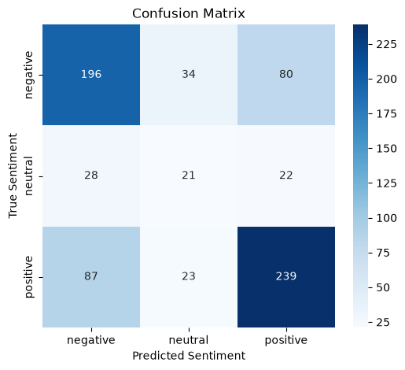

# Reddit Sentiment Analysis

[](https://github.com/Benassi-Riccardo/ML-Sentiment-Analysis-on-Reddit-user-s-Data/actions/workflows/deploy.yml)

An end-to-end NLP pipeline that classifies Reddit posts as **positive**, **neutral** or **negative**,
from raw data to a containerised REST API with automatic deployment.

**Stack:** Python · scikit-learn · NLTK · VADER · MLflow · FastAPI · Docker · GitHub Actions · Render

## Architecture

```
redditDataset.pkl
   │  src/data_ingestion.py       load + validate, export Dataset.csv
   ▼
   │  src/data_transformation.py  deduplicate, VADER-label, clean text → processed_dataset.csv
   ▼
   │  src/model_trainer.py        TF-IDF + logistic regression, metrics, MLflow logging
   ▼
sentiment_model.pkl ──► app.py (FastAPI)  ──► Docker ──► GitHub Actions ──► Render
```

The same `clean_and_preprocess` function (`src/text_preprocessing.py`) is used for training and
serving, so the API sees text normalised exactly like the training data.

## Data

[Reddit comments from the r/humor and r/news subreddits (Kaggle)](https://www.kaggle.com/datasets?search=reddit+comments+from+subreddits+humour+and+news).
Download `redditDataset.pkl` into the project root. It is not committed to this repository.

The file has 100,000 rows but only **3,651 unique texts**. Roughly 96% of rows are repeats.
The pipeline drops duplicates (by raw text, then by cleaned text) **before** the train/test split.
An earlier version of this project skipped that step and reported 99.9% accuracy, which came
entirely from test posts that also appeared in the training set.

## Labels: a weak-supervision caveat

The dataset has no sentiment labels, so they are generated with
[VADER](https://github.com/cjhutto/vaderSentiment) (compound ≥ 0.05 → positive, ≤ −0.05 → negative,
otherwise neutral). The classifier therefore learns to approximate VADER, and the metrics below
measure **agreement with VADER, not with human judgement**.

## Results

Hold-out test set: 20%, stratified, 730 posts. Logistic regression uses `class_weight="balanced"`.

| Class        | Precision | Recall | F1   | Support |
|--------------|-----------|--------|------|---------|
| negative     | 0.63      | 0.63   | 0.63 | 310     |
| neutral      | 0.27      | 0.30   | 0.28 | 71      |
| positive     | 0.70      | 0.68   | 0.69 | 349     |
| **accuracy** |           |        | **0.62** | 730 |
| macro avg    | 0.53      | 0.54   | 0.54 |         |

The majority-class baseline (always "positive") scores 0.48 accuracy. Without class weighting
the model never predicted "neutral" (macro F1 0.44).



**Known limitations**
- English only. If none of the input words are in the training vocabulary (for example, Italian
  text), the API returns HTTP 422 instead of guessing.
- About 3.6k training examples is small for bag-of-words. For example, "not good, terrible news"
  is currently predicted as positive.
- Neutral is under-represented (~10%) and remains the weakest class.
- Labels are VADER's, so the model cannot be more correct than VADER.

**Next steps:** hand-label a gold test set to measure real accuracy (VADER vs this model), and
compare against a small transformer such as DistilBERT.

## Quick start

```bash
python -m venv .venv
.venv/Scripts/activate          # Windows; use `source .venv/bin/activate` on macOS/Linux
pip install -r requirements.txt

python -m src.data_ingestion
python -m src.data_transformation
python -m src.model_trainer     # logs the run to MLflow; view with `mlflow ui`

python -m unittest discover -s tests -v
python -m uvicorn app:app --reload   # open http://127.0.0.1:8000/docs
```

Example request:

```bash
curl -X POST http://127.0.0.1:8000/predict -H "Content-Type: application/json" -d "{\"text\": \"I love this, best day ever!\"}"
```

```json
{"raw_text": "I love this, best day ever!", "cleaned_text": "love best day ever", "predicted_sentiment": "positive", "confidence": 0.XX}
```

The trained `sentiment_model.pkl` (~300 KB) is committed so the Docker image can serve without
retraining. Load it with the pinned `scikit-learn` version from `requirements.txt`.

## Deployment

On every push to `main`, GitHub Actions runs the tests, builds the Docker image and triggers a
Render deploy hook. See [DEPLOYMENT.md](DEPLOYMENT.md) for setup.

## License

[MIT](LICENSE)
